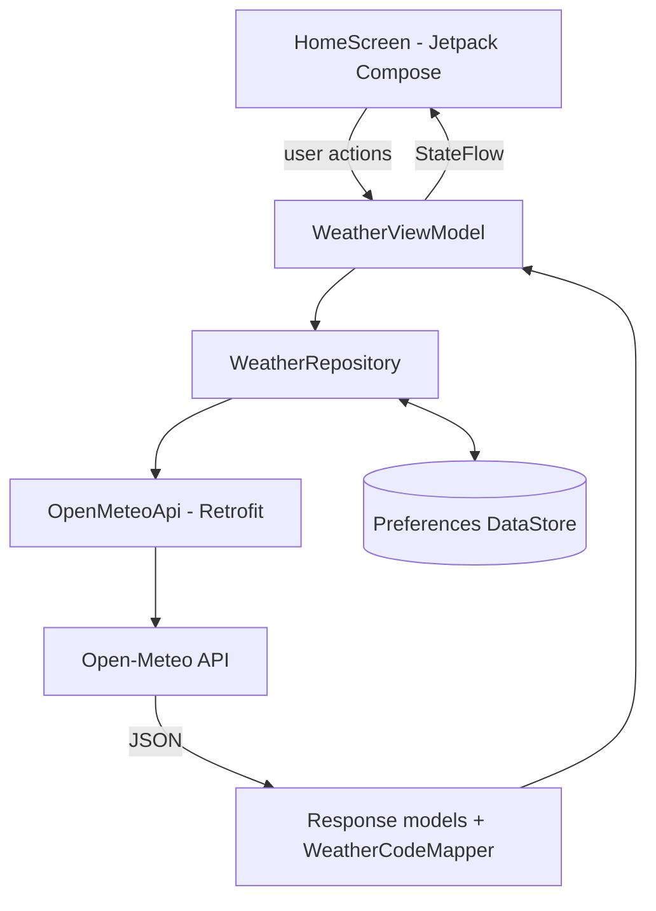

# WeatherApp

A native Android weather app built with Kotlin and Jetpack Compose. It uses Open-Meteo to find cities and show their current weather, a five-day forecast and hourly details, and it keeps working with saved data when the network is unavailable.

I built WeatherApp to practice the parts of Android development that matter in a real app: working with a REST API, keeping asynchronous work under control, modelling UI state, and handling failures without leaving the user with a blank screen. The code is deliberately small and readable, with a lightweight MVVM structure and no frameworks beyond what the app needs.

## Features

- **City search:** search by name through the Open-Meteo Geocoding API, with debounced input, suggestions showing name, region and country, and in-memory prefix caching.
- **Current weather:** temperature in °C, condition with icon, relative humidity and wind speed for the selected city.
- **Five-day forecast:** date, condition icon, and maximum and minimum temperature for each day.
- **Interactive hourly forecast:** select any day to see its hourly temperatures and conditions. The data comes from the existing forecast response, so changing the day makes no extra request.
- **Offline support:** the last successful city and forecast are saved with Preferences DataStore and restored on launch. Saved data is shown when the network is unavailable and is marked as possibly outdated.
- **Failure handling:** loading, empty, no-result and error states for both search and forecast, with retry for failed requests.

## How It Works

1. The user opens the app. If a forecast was saved earlier, it is shown immediately and a refresh starts in the background. Otherwise a search prompt is shown.
2. The user types a city name. The input is debounced, so a request is sent only after they pause typing.
3. The Geocoding API returns matching cities, which appear as suggestions.
4. The user selects a city, and the app keeps its name, country, latitude and longitude.
5. The coordinates go to the forecast flow, where the repository requests current, hourly and daily weather from Open-Meteo.
6. The JSON response is parsed into Kotlin data models.
7. `WeatherCodeMapper` turns the numeric WMO weather codes into readable descriptions and icons.
8. `WeatherViewModel` updates its UI state, and Jetpack Compose redraws the screen with current conditions and the five-day forecast.
9. The user taps a day to see its hourly forecast, taken from the data already loaded.
10. After each successful load, the city and forecast are saved locally. If a later refresh fails, the saved forecast stays on screen with a notice that it may be outdated.

If there is no saved data and no connection, the app shows an error with a retry option.

## Architecture

The app follows a lightweight MVVM structure with a single screen and one-directional data flow: the UI sends user actions to the ViewModel, and the ViewModel exposes state that the UI observes.



| Component | Responsibility |
| --- | --- |
| `HomeScreen` | Renders the UI and forwards user interactions |
| `WeatherViewModel` | Holds UI state, debounces search, starts and cancels forecast requests, tracks the selected day |
| `WeatherRepository` | Sits between the ViewModel and data sources, coordinating the network and the saved data |
| `OpenMeteoApi` | Defines the geocoding and forecast endpoints |
| `ApiClient` | Configures Retrofit, OkHttp (including timeouts) and JSON serialization |
| `WeatherDataStore` | Reads and writes the last successful city and forecast |
| Models | Data classes for geocoding and forecast responses |
| `WeatherCodeMapper` | Interprets WMO weather codes and maps daily and hourly forecast data |

## Technology Stack

| Technology | Role in the app |
| --- | --- |
| Kotlin | Primary language |
| Jetpack Compose, Material 3 | Declarative UI and theming |
| ViewModel | Keeps UI state through configuration changes such as rotation |
| Kotlin Coroutines | Network calls, debouncing and cancellation without blocking the main thread |
| StateFlow | Exposes UI state for Compose to observe |
| Retrofit, OkHttp | REST calls and request timeouts |
| Kotlinx Serialization | Parses JSON into data models |
| Preferences DataStore | Stores the last successful city and forecast for offline use |
| Open-Meteo | Geocoding and weather data |
| Gradle Kotlin DSL | Build configuration, with dependencies in a version catalog |

Package: `com.samay.weatherapp`. Minimum SDK: API 26.

## API Integration

Open-Meteo needs no API key for this project's usage.

- **Geocoding** (`https://geocoding-api.open-meteo.com/v1/search`) turns a city name into candidate locations with their names, countries and coordinates.
- **Forecast** (`https://api.open-meteo.com/v1/forecast`) takes a latitude and longitude and returns current conditions, hourly data and daily forecasts.

The coordinates from the selected city connect the two calls. Weather conditions arrive as numeric WMO weather interpretation codes, which `WeatherCodeMapper` translates in one place. Unknown codes fall back to a generic description instead of breaking the UI.

## Engineering Decisions

- **Debounce plus prefix caching:** every keystroke would otherwise trigger a geocoding request. Debouncing waits for a pause, and cached results for a shorter prefix are filtered locally as the user keeps typing.
- **Cancelling outdated requests:** if the user selects another city while a forecast is loading, the earlier job is cancelled. This stops a slow response for an old city from replacing the new selection, and cancellation is not reported as an error.
- **Independent search and forecast states:** a failed search should not clear the weather on screen, and a failed forecast should not hide the search field. Separate states keep each concern isolated.
- **Safe mapping of parallel arrays:** Open-Meteo returns dates, weather codes and temperatures as separate arrays. The mapping logic checks their lengths before combining them into one entry per day or hour.
- **Reusing hourly data:** the forecast response already contains hourly values for all five days, so selecting a day filters data in memory instead of calling the API again.
- **Keeping cached data on failure:** a failed refresh leaves the last good forecast visible with an outdated notice, because stale weather is more useful than an error screen.

## Project Structure

A representative layout of the important parts:

```text
WeatherApp/
├── app/src/main/
│   ├── java/com/samay/weatherapp/
│   │   ├── data/
│   │   │   ├── local/        # Preferences DataStore storage
│   │   │   ├── remote/       # Retrofit API definition and client setup
│   │   │   └── repository/   # WeatherRepository
│   │   ├── model/            # Geocoding and forecast models
│   │   ├── ui/               # HomeScreen, ViewModel, UI state, theme
│   │   ├── util/             # WeatherCodeMapper
│   │   └── MainActivity.kt
│   └── AndroidManifest.xml
└── gradle/
    └── libs.versions.toml
```

## Getting Started

### Prerequisites

- Android Studio
- Android SDK (installed through Android Studio)
- A compatible JDK (the one bundled with Android Studio works)
- An Android emulator or device running API 26 or above

### Run the app

```bash
git clone https://github.com/Samay1011/WeatherApp.git
cd WeatherApp
```

1. Open Android Studio, choose **Open**, and select the `WeatherApp` folder.
2. Wait for the Gradle sync to complete.
3. Select an emulator or connected device.
4. Run the `app` configuration.

An internet connection is needed to search and refresh weather. No release APK is provided; build it from source as above.

## Limitations and Future Scope

- Weather data depends on the availability and accuracy of the Open-Meteo service.
- Only the most recent city and forecast are saved, and searching a new city needs a connection.
- Temperatures are shown in Celsius only.

Possible next steps:

- Current location weather with runtime permission handling
- Celsius/Fahrenheit preference
- Weather alerts and notifications
- Weather charts and other forecast visualizations
- More detailed forecast information